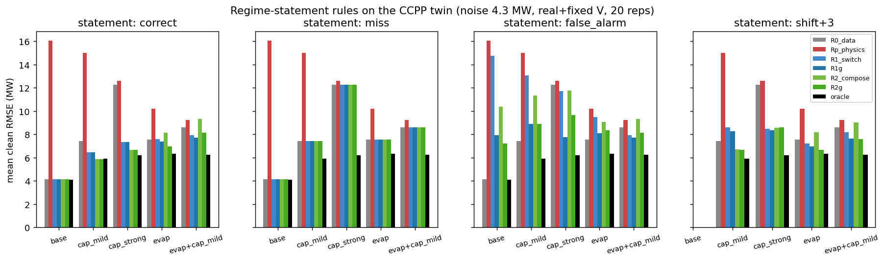

# 레짐 진술을 받는 외삽 판단 규칙 — 사전 등록

마지막 갱신: 2026-11-04  
상태: **사전 등록. §1–§8은 결과를 보기 전에 썼고 커밋했다.** 결과는 §9에 붙이고, 사전 등록 부분을 고치면 이유와 날짜를 §10에 남긴다.

[격자 실험 결과](ccpp-twin-grid.md) · [CCPP 외삽 설계와 가정](ccpp-extrapolation.md) · [쌍둥이 설계](ccpp-twin-design.md)

## 1. 왜 이 실험인가

[격자 실험](ccpp-twin-grid.md#8-결과-2026-11-04)에서 확인한 것:

- 물리 고정 기울기(비례식)는 학습 창과 시험 구간 사이에 **레짐 경계**가 있을 때만 이긴다.
- 그 경계는 창 밖에 있어서 창 데이터로 계산한 지표로는 볼 수 없다(A6 원형 기각).

그러므로 판단에 필요한 정보는 데이터 밖에서 와야 한다. 이 실험은 그 정보를 **레짐 진술**(사람이나 LLM이 주는 정성적 추천)로 받는다. 묻는 질문은 세 가지다.

1. 진술이 맞으면 외삽 오차가 얼마나 줄어드는가
2. 진술이 틀리면(누락, 거짓 경보, 위치 오차) 얼마나 손해를 보는가
3. 진술 중 **데이터로 검사할 수 있는 부분**만 검사해서 손해를 얼마나 막을 수 있는가

LLM은 추천만 한다는 원래 제약을 따른다. 정답 함수 형태는 주지 않는다. 진술은 “어디서 출력이 평평해진다” 수준의 모듈 정보다.

## 2. 레짐 진술의 형식

진술은 AT 축 위의 **레짐 지도**다. 경계 목록으로 표현한다.

```
[ {"side": "below", "at": 9.0,  "type": "flat"},   # 9°C 아래는 평평
  {"side": "above", "at": 24.0, "type": "flat"} ]  # 24°C 위는 평평
```

- 경계 바깥 구간의 형태는 `flat`(출력이 AT에 거의 반응하지 않음) 하나만 둔다. 경계 안쪽은 `normal`이다.
- 숫자 기울기는 진술에 들어가지 않는다. 기울기는 아래 §4의 모듈이 정한다.

## 3. 쌍둥이 세계의 정답 진술

정답은 쌍둥이 내부 상태로 정한다. 실제 PE는 쓰지 않는다.

| 세계 | 정답 진술 | 근거 |
|---|---|---|
| `base` | 없음 | 레짐 모듈 없음 |
| `cap_mild` | below 6°C flat | 실제 입력에서 상한에 걸리는 행이 50%가 되는 AT (6–7°C 구간 48%) |
| `cap_strong` | below 9°C flat | 같은 기준 (9–10°C 구간 51%) |
| `evap` | above 24°C flat | 증발냉각 램프 중심 `evap_on_c` |
| `evap+cap_mild` | below 6°C flat, above 24°C flat | 두 모듈 |

증발냉각은 점진적이다(24°C에서 흡기 냉각 약 2 K, 34°C에서 약 9 K). 그래서 `flat`이라는 진술이 고온 쪽에서는 과장이다. 일부러 이 거친 진술을 그대로 쓴다. 실제 LLM 진술도 이 정도로 거칠 것이기 때문이다.

## 4. 판단 규칙

모두 학습 창 데이터, 시험 입력 X, 진술만 쓴다.

| 이름 | 내용 |
|---|---|
| `R0_data` | 항상 `raw_linear` (PE ~ AT + V + AP + RH) |
| `Rp_physics` | 항상 `proportional` (기울기 고정 비례식) |
| `R1_switch` | 창 중심과 시험 구간 중심 사이에 진술된 경계가 하나라도 있으면 `proportional`, 없으면 `raw_linear` |
| `R2_compose` | 구간별 기울기를 이어 붙인다. 아래 정의 |
| `R1g`, `R2g` | 위 규칙에 §5의 검사를 붙인 것. 검사에서 진술이 기각되면 `R0_data`로 돌아간다 |
| `oracle` | 칸마다 `raw_linear`와 `proportional` 중 나은 쪽 (시험 정답 사용, 상한 참고용) |

`R2_compose`의 정의:

- 창 가장자리 e(시험 쪽)에서 `raw_linear`로 예측한 값에서 출발한다. AT만 e로 바꾸고 V·AP·RH는 시험 행 값을 쓴다.
- e에서 시험 AT까지 AT 기울기 s(t)를 적분해 더한다.
- s(t)는 t가 속한 진술 구간의 형태로 정한다.
  - 창 중심과 같은 형태의 구간이면 데이터 기울기(`raw_linear`의 AT 계수)를 쓴다.
  - 창과 다른 형태의 `normal` 구간이면 물리 기울기(비례식 기울기 −mean(PE)/mean(T_K))를 쓴다.
  - 창과 다른 형태의 `flat` 구간이면 0을 쓴다.
- 민감도 분석으로 `flat` 기울기를 0 대신 0.5 × 물리 기울기로 바꾼 `R2_compose_half`도 보고한다.

## 5. 진술 검사 (데이터로 검사할 수 있는 부분만)

진술은 두 부분으로 나뉜다.

- **창에 대한 주장:** 창 중심이 `normal`인지 `flat`인지. 창 데이터로 검사할 수 있다.
- **창 밖에 대한 주장:** 창 밖 어디에 경계가 있는지. 데이터로 검사할 수 없다.

검사 규칙: 창 데이터 기울기 b와 표준오차 SE로 z_normal = |b − 물리 기울기| / SE, z_flat = |b| / SE를 계산한다. 진술된 창 형태의 z가 다른 형태의 z보다 2 이상 크면 진술을 기각한다.

이 검사는 창 밖에 대한 주장을 검사하지 못한다. 그래서 창 밖 거짓 경보는 막지 못할 것으로 예상한다. 이 비대칭을 정량으로 보이는 것이 이 실험의 목표 중 하나다.

## 6. 진술 오류 종류

| 이름 | 만드는 법 |
|---|---|
| `correct` | §3의 정답 |
| `miss` | 정답 경계를 모두 뺀다. 경계가 둘인 세계에서는 하나씩 뺀 `miss_cold`, `miss_hot`도 만든다 |
| `false_alarm` | 정답에 없는 쪽에 경계를 더한다. 저온 쪽은 below 9°C flat, 고온 쪽은 above 24°C flat |
| `shift±3`, `shift±6` | 정답 경계를 모두 같은 방향으로 ±3°C, ±6°C 옮긴다 |

`base` 세계에서는 `correct`와 `miss`가 같고, `shift`는 정의되지 않는다.

## 7. 실험 조건과 지표

- 세계: 잡음 4.3 MW, 레짐 모듈 5종 × V(실제 / 고정) = 10개
- 창, 폭, 거리, 반복: [격자 실험 §3](ccpp-twin-grid.md#3-학습-창과-시험-구간)과 같다. 같은 seed 규칙을 쓴다
- 지표 (잡음 없는 쌍둥이 출력 기준):
  - 평균 RMSE
  - `oracle` 대비 regret
  - **피해율:** `R0_data`보다 1 MW 넘게 나쁜 칸의 비율
  - 검사의 진술 기각률(진술 종류별)
- 보고 단위: 세계 × 규칙 × 진술 종류. 창 위치·거리별 표도 함께 낸다

## 8. 사전 예측

| # | 예측 |
|---|---|
| Q1 | 정답 진술에서 `R1_switch`는 레짐이 있는 모든 세계에서 `R0_data`와 `Rp_physics`보다 평균 RMSE가 낮다. `base`에서는 `R0_data`와 같다 |
| Q2 | 정답 진술에서 `R2_compose`는 증발냉각 세계의 d ≥ 15에서 `R1_switch`보다 낫다. d = 5에서는 고온 `flat` 과장 때문에 `R1_switch`보다 나쁘다 |
| Q3 | `miss`이면 `R1_switch`와 `R2_compose`는 `R0_data`와 같아진다. 이득을 잃을 뿐 `R0_data`보다 나빠지지 않는다 |
| Q4 | `false_alarm`은 `base` 세계에서 `R1_switch`의 피해율을 크게 올린다. 검사(`R1g`)는 창이 거짓 `flat` 구간 안에 있을 때만 막고, 중간 창에서 거짓 경계를 향하는 경우는 막지 못한다 |
| Q5 | `shift±3`은 `R1_switch`에 거의 영향이 없고 `R2_compose`에는 영향이 있다. `shift±6`은 둘 다 성능을 크게 떨어뜨린다 |
| Q6 | 정답 진술에서 검사의 잘못된 기각률은 낮다(10% 미만). 단, 창이 경계에 걸친 `cap_mild` 저온 창은 예외일 수 있다 |

## 9. 결과 (2026-11-04)

실행: `python analysis/ccpp_twin/regime_rules.py <xlsx> --reps 20` (6초). 요약은 `regime_summary.json`, `regime_summary.txt`, 그림은 `regime_rules.png`에 있다. 구현 점검: `R0_data`·`Rp_physics`는 격자 실험의 `raw_linear`·`proportional`과 같은 칸에서 정확히 일치했다. `miss`일 때 `R1`·`R2`는 `R0`과 같았다(차이 최대 2×10⁻¹² MW).



주의: `evap+cap_mild` 세계에는 빈 쪽이 없어서 `false_alarm`이 `correct`와 같다.

### 9.1 주요 수치 (평균 RMSE MW, 괄호는 `R0_data`보다 1 MW 넘게 나쁜 칸의 비율)

| 세계 | 진술 | R0_data | Rp_physics | R1_switch | R1g | R2_compose | R2g | oracle |
|---|---|---:|---:|---:|---:|---:|---:|---:|
| base | correct | 4.16 | 16.04 | 4.16 | 4.16 | 4.16 | 4.16 | 4.09 |
| base | false_alarm | 4.16 | 16.04 | 14.74 (82%) | 7.93 (31%) | 10.35 (73%) | 7.21 (29%) | 4.09 |
| cap_mild | correct | 7.41 | 14.99 | 6.45 | 6.44 | **5.87** | **5.87** | 5.92 |
| cap_strong | correct | 12.26 | 12.59 | 7.33 | 7.33 | 6.67 | 6.67 | 6.21 |
| cap_strong | false_alarm | 12.26 | 12.59 | 11.73 (50%) | 7.77 (21%) | 11.75 (47%) | 9.66 (21%) | 6.21 |
| evap | correct | 7.54 | 10.21 | 7.60 (23%) | 7.36 (10%) | 8.15 (35%) | 6.94 (12%) | 6.31 |
| evap+cap_mild | correct | 8.58 | 9.21 | 7.93 | 7.70 | 9.30 | 8.13 | 6.23 |
| 모든 세계 | miss | = R0 | | = R0 (0%) | = R0 | = R0 (0%) | = R0 | |

### 9.2 사전 예측 대조

| # | 결과 | 판정 |
|---|---|---|
| Q1 | `cap_mild`, `cap_strong`, `evap+cap_mild`에서는 맞다(`cap_strong` 12.3 → 7.3 MW). `evap`에서는 `R1_switch` 7.60 대 `R0` 7.54로 이득이 없다. `base`에서는 같다 | **부분적으로 맞음.** 점진적인 레짐(증발냉각)에는 “flat” 진술이 너무 거칠다 |
| Q2 | `evap`에서 맞다(d = 15: 11.1 대 11.9, d = 20: 14.0 대 15.0, d = 5: 4.6 대 3.7). `evap+cap_mild`에서는 먼 거리에서도 `R2`가 더 나쁘다(d = 20: 18.6 대 13.7) | **부분적으로 맞음** |
| Q3 | `miss`이면 모든 세계에서 `R0`과 같고 피해율 0% | **맞음** (구성상 보장) |
| Q4 | `base` `false_alarm`에서 `R1` 피해율 82%. 검사를 붙이면 31%. 창 쪽 주장을 검사할 수 있는 `cold→hot`·`hot→cold`에서는 피해율이 87% → 18%, 90% → 0%로 줄고, 중간 창(`mid→cold` 55%, `mid→hot` 93%)에서는 **전혀 줄지 않는다** | **맞음.** 검사 가능/불가능의 비대칭이 그대로 나왔다 |
| Q5 | `shift+3`에서 `cap_mild` `R1`이 6.45 → 8.59(피해율 25%)로 나빠진다. 경계가 창 반대편으로 옮겨 가는 `shift−3`, `shift−6`은 `miss`와 같아진다 | **틀림.** 위치 오차의 영향은 크기보다 **경계가 창의 어느 쪽에 놓이느냐**로 정해진다 |
| Q6 | 저온 상한 세계의 잘못된 기각률은 낮다(`cap_mild` 저온 w2.5만 15%, 예상한 예외). 그러나 `evap` 고온 창에서는 정답 진술이 92–100% 기각된다 | **틀림.** 고온 창의 실제 기울기가 0이 아니어서 “flat” 주장이 데이터와 맞지 않는다. 검사가 틀린 것이 아니라 진술이 과장된 것이다 |

### 9.3 해석

1. **진술이 맞고 레짐이 뚜렷하면 이득이 크다.** `cap_strong`에서 오차가 12.3 → 6.7 MW로 줄어 칸별 oracle(6.2)에 가깝다. `cap_mild`에서는 `R2_compose`(5.87)가 칸별로 `raw_linear`와 `proportional` 중 나은 쪽을 고르는 oracle(5.92)보다도 낫다. **고르기보다 구간별로 조립하는 쪽이 낫다**는 뜻이다.
2. **누락은 안전하고, 거짓 경보가 위험이다.** 누락은 데이터 적합으로 돌아갈 뿐이다. 거짓 경보는 레짐이 없는 세계에서 칸의 82%를 망친다.
3. **진술은 검사 가능한 부분과 불가능한 부분으로 나뉜다.**
   - 창에 대한 주장은 창 데이터로 검사할 수 있고, 검사는 그 부분의 피해를 대부분 막는다.
   - 창 밖에 대한 주장은 검사할 수 없고, 그 부분의 피해는 그대로 남는다(중간 창 피해율 55–93%).
   - 이것이 이 실험의 가장 중요한 결과다. **LLM 진술의 위험은 “데이터로 반증할 수 없는 부분”에 모인다.**
4. **점진적 레짐에는 이진 진술이 맞지 않는다.** 증발냉각처럼 서서히 평평해지는 구간에 “flat”이라고 말하면 이득이 거의 없다. 검사는 이 과장을 잡아낸다(고온 창 기각 92–100%).
5. **경계 위치 오차는 방향이 중요하다.** 경계가 창 반대편으로 밀리면 누락과 같아지고, 시험 쪽으로 밀리면 거짓 경보와 비슷해진다.

### 9.4 논문 주장 후보와 다음 설계 질문

주장 후보: “외삽에 쓰는 외부 레짐 진술은 데이터로 검사할 수 있는 부분과 없는 부분으로 분해된다. 검사 가능한 부분은 데이터로 걸러 낼 수 있고, 검사 불가능한 부분의 위험은 별도로 묶어야 한다.” 겹침 검토는 아직 하지 않았다.

다음 질문:

1. **검사할 수 없는 부분의 위험 제한:**
   - 진술 하나에 전부 거는 대신 `R0`과 `R2`를 섞는 최소최대(minimax) 가중을 쓴다.
   - 또는 거리 상한을 둔다.
   - 거짓 경보 피해를 얼마나 줄이고 정답일 때 이득을 얼마나 잃는지 잰다.
2. **진술 형식 확장:** `flat` 하나 대신 `flatter`(완만해짐)와 대략적인 정도를 받아 점진적 레짐을 다룬다.
3. **실제 LLM 진술:** 같은 형식으로 여러 LLM에서 진술을 받아, 오류 종류(누락·거짓 경보·위치)의 실제 빈도를 잰다. 그 빈도로 기대 이득을 계산한다.
4. **실데이터(A7):** 실제 CCPP에 같은 규칙을 적용한다. 실데이터에서는 정답 레짐을 모르므로 LLM 진술과 검사 결과만으로 판단한다.

## 10. 사전 등록 수정 기록

(없음)
