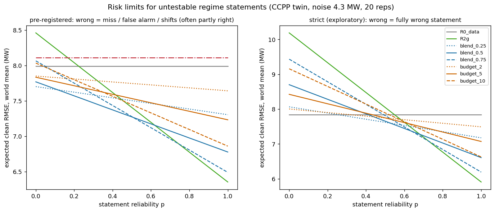

# 검사할 수 없는 진술의 위험 제한 — 사전 등록

마지막 갱신: 2026-11-04  
상태: **사전 등록. §1–§8은 결과를 보기 전에 썼고 커밋했다.** 결과는 §9에 붙이고, 사전 등록 부분을 고치면 이유와 날짜를 §10에 남긴다.

[레짐 진술 규칙 결과](ccpp-regime-statement.md) · [겹침 검토](reviews/2026-11-04-regime-statement-overlap.md)

## 1. 문제

[레짐 진술 실험](ccpp-regime-statement.md#9-결과-2026-11-04)에서 확인한 것:

- 진술 중 **창에 대한 주장**은 창 데이터로 검사해 걸러낼 수 있다.
- **창 밖에 대한 주장**(“시험 쪽 어딘가에 경계가 있다”)은 검사할 수 없다. 틀리면 피해가 그대로 남는다(레짐 없는 세계에서 피해율 82%).

[겹침 검토](reviews/2026-11-04-regime-statement-overlap.md)에 따르면, 논문의 기여는 **검사할 수 없는 부분의 위험을 어떻게 묶는가**에 있어야 한다. 이 실험은 그 규칙을 설계하고 비교한다.

## 2. 설계 원칙

1. **데이터 기반 예측 `R0`(데이터 적합)을 기준점으로 둔다.** `R0`은 진술이 없을 때의 예측이다.
2. **진술이 바꾸는 양을 분리한다.** 진술이 바꾸는 양은 Δ(x) = R2g(x) − R0(x)이다. `R2g`는 검사를 통과한 진술로 구간별 기울기를 조립한 예측이다. Δ는 정답 없이 계산된다. Δ가 곧 “검사할 수 없는 주장에 걸린 크기”다.
3. **Δ를 얼마나 반영할지를 위험 제한 규칙이 정한다.** 반영 비율이나 반영 상한을 정하는 근거는 진술의 신뢰도 p, 또는 사용자가 허용하는 추가 오차 ε다.

## 3. 위험 제한 규칙

| 이름 | 예측 | 성질 |
|---|---|---|
| `blend_λ` | R0 + λ·Δ, λ ∈ {0.25, 0.5, 0.75} | 진술이 맞을 확률이 p이고 정답이 R0 또는 R2g 중 하나라면, 제곱 손실을 최소화하는 λ는 p다. λ = 0.5는 신뢰도 정보가 없을 때의 최소최대 선택이다 |
| `budget_ε` | R0 + clip(Δ, −ε, ε), ε ∈ {2, 5, 10} MW | **보장:** 진술이 어떻게 틀려도 \|예측 − 정답\| ≤ \|R0 − 정답\| + ε (삼각부등식). 진술 때문에 늘어나는 오차가 행마다 ε 이하다. 이득도 행마다 ε 이하로 묶인다 |
| `R2g` | 검사 후 구간 조립 (λ = 1, ε = ∞) | 이전 실험의 규칙. 위험 제한 없음 |
| `R0_data` | λ = 0 | 진술 무시 |

## 4. 비교군 (겹침 검토에서 나온 것)

| 이름 | 내용 | 대응하는 선행연구 |
|---|---|---|
| `coef_prior` | `raw_linear`의 AT 계수를 물리 기울기(비례식 기울기) 쪽으로 수축한다. 수축 강도는 창 안 5겹 교차검증으로 정한다(10⁻²–10⁶). 진술은 쓰지 않는다 | LoID, Langseth 외의 “LLM 계수 prior를 수축 목표로 쓰기”. LLM 대신 물리 기울기를 넣으므로, 계수 prior로서는 유리한 조건이다 |
| `pb_mid` | 창 안에서 PE ~ AT + AT² + V + AP + RH를 적합한다. 창 양 끝의 AT 도함수를 기울기 범위로 삼아, 창 가장자리 예측에서 기울기 범위만큼 벌린 구간의 중점을 예측으로 쓴다. 구간 `pb_lo`–`pb_hi`의 정답 포함률도 보고한다 | Pfister & Bühlmann의 가정(“기울기의 최댓값·최솟값은 관측 범위 안에서 나온다”)을 **단순화한 구현**이다. 원 방법(비모수 추정)과 같지 않다 |

## 5. 실험 조건

- 세계, 창, 거리, 반복, seed: [레짐 진술 실험 §7](ccpp-regime-statement.md#7-실험-조건과-지표)과 같다(잡음 4.3 MW, 10개 세계)
- 진술 종류도 같다: `correct`, `miss`, `false_alarm`, `shift±3`, `shift±6`, (`miss_cold`, `miss_hot`)
- 지표 (잡음 없는 쌍둥이 출력 기준):
  - 평균 RMSE
  - 피해율(`R0`보다 1 MW 넘게 나쁜 칸 비율)
  - **행 단위 최대 추가 오차** max(\|예측 − 정답\| − \|R0 − 정답\|)
  - `pb` 구간의 정답 포함률

## 6. 핵심 분석: 진술 신뢰도에 따른 기대 오차

진술이 맞을 확률을 p라 하자. 세계마다 기대 RMSE를 다음처럼 정의한다.

E_p = p · L(correct) + (1 − p) · L(wrong)

- L(wrong)은 그 세계에서 정의되는 틀린 진술 종류들의 평균 RMSE다: `miss`, `false_alarm`(정답과 다를 때만), `shift±3`, `shift±6`, 그리고 있으면 `miss_cold`, `miss_hot`.
- `base` 세계에서는 L(wrong) = L(`false_alarm`)이다. 이 세계에서 맞는 진술은 “경계 없음”이다.

p를 0부터 1까지 바꾸며 세계 평균 E_p를 그린다. 규칙마다 **`R0`보다 나아지는 최소 신뢰도 p\***(손익분기 신뢰도)를 구한다.

이 수치가 다음 단계(실제 LLM 진술 수집)와 연결된다. 실제 LLM의 진술 정확도를 재서 p\*와 비교하면, 그 LLM을 쓸지 말지 판단할 수 있다.

## 7. 사전 예측

| # | 예측 |
|---|---|
| H1 | `budget_ε`의 행 단위 최대 추가 오차는 모든 진술 종류에서 ε 이하다 (구성상 보장. 구현 점검용) |
| H2 | `budget_5`는 `cap_strong` 정답 진술에서 `R2g` 이득(12.3 → 6.7 MW)의 절반 이상을 유지하고, `base` 거짓 경보에서 평균 RMSE를 `R2g`(7.2 MW)보다 낮춘다 |
| H3 | `blend_0.5`의 손익분기 신뢰도 p\*는 `R2g`의 p\*보다 낮다. 즉 덜 믿을 만한 진술로도 이득을 본다 |
| H4 | `coef_prior`는 레짐 세계에서 `R0`보다 거의 낫지 않다(평균 RMSE 개선 1 MW 미만). 계수 prior로는 레짐을 표현할 수 없다 (LoID의 CCPP 실패와 같은 방향) |
| H5 | `pb` 구간의 정답 포함률은 `base` 세계보다 `cap_*` 세계의 `cold→hot`에서 낮다. 평평한 창 밖에서 기울기가 가팔라져 가정이 깨지기 때문이다 |
| H6 | 신뢰도 p가 높을수록(p ≥ 0.8) `R2g`가, 낮을수록 `budget`·`blend`가 기대 RMSE에서 유리하다. 모든 p에서 이기는 규칙은 없다 |

## 8. 이 실험이 주장하지 않는 것

- 진술은 아직 실제 LLM에서 받지 않았다. p는 가정한 값이다.
- `pb_mid`는 Pfister & Bühlmann의 원 방법이 아니다. 논문에 비교군으로 넣으려면 원 방법을 구현해야 한다.
- `coef_prior`는 LLM 계수 대신 물리 기울기를 쓴다. LoID와 같은 조건이 아니다.

## 9. 결과 (2026-11-04)

실행: `python analysis/ccpp_twin/risk_limits.py <xlsx> --reps 20` (13초).

- 출력 파일
  - 요약: `risk_summary.json`, `risk_summary.txt`
  - 엄격 분석: `risk_strict.json`
  - 그림: `risk_frontier.png`
- 구현 점검
  - `R0`·`R2g`가 [레짐 진술 실험](ccpp-regime-statement.md)의 값과 같은 칸에서 정확히 일치했다.
  - `budget_ε`의 행 단위 최대 추가 오차는 정확히 ε였다(2.0, 5.0, 10.0 MW).

### 9.1 사전 등록 정의로는 손익분기 신뢰도가 과소평가된다

사전 등록한 “틀린 진술” 묶음(`miss`, `false_alarm`, `shift±3·±6`)은 대부분 **일부가 맞는 진술**이었다.

- `miss`는 손해가 없다.
- 경계가 창 반대편으로 밀린 `shift`는 `miss`와 같아진다.
- 레짐 세계의 `false_alarm`은 정답 경계를 그대로 두고 경계를 하나 더한 것이다.

그래서 사전 등록 정의로 계산한 손익분기 신뢰도 p\*는 `R2g` 0.25, `blend`·`budget` 0~0.05로 매우 낮게 나왔다(왼쪽 그림). 이 값은 “진술이 완전히 틀려도 괜찮다”는 뜻이 아니다. 오류 대부분이 반쯤 맞는 오류였다는 뜻이다.

이를 보완하려고 **사전 등록에 없던 탐색 분석**을 더했다(§10). 이 분석에서 “완전히 틀린 진술”은 다음과 같다.

- `base`: 거짓 경보
- `cap_*`: 정답(저온 쪽 경계) 대신 반대쪽 경계 above 24°C flat만 말한 진술 `swap`
- `evap`: 정답 대신 below 9°C flat만 말한 진술 `swap`

이 정의로 다시 계산한 결과가 오른쪽 그림과 아래 표다.

| 규칙 | 손익분기 p\* (엄격) | p = 1 기대 RMSE | p = 0 기대 RMSE | 성질 |
|---|---:|---:|---:|---|
| `R0_data` | — | 7.84 | 7.84 | 진술 무시 |
| `R2g` | 0.55 | **5.91** | 10.19 | 이득 최대, 위험 최대 |
| `blend_0.75` | 0.50 | 6.19 | 9.43 | |
| `blend_0.5` | 0.45 | 6.61 | 8.70 | |
| `blend_0.25` | **0.30** | 7.18 | 8.07 | 위험 최소 |
| `budget_10` | 0.55 | 6.63 | 9.16 | 행마다 추가 오차 ≤ 10 MW 보장 |
| `budget_5` | 0.45 | 7.07 | 8.42 | ≤ 5 MW 보장 |
| `budget_2` | 0.35 | 7.49 | 8.00 | ≤ 2 MW 보장 |
| `coef_prior` | 없음 | 8.11 | 8.11 | 진술을 쓰지 않음 |
| `pb_mid` | 없음 | 8.11 | 8.11 | 진술을 쓰지 않음 |

신뢰도별로 가장 좋은 규칙(엄격 정의):

| 신뢰도 p | 가장 좋은 규칙 |
|---|---|
| 0.25 이하 | `R0` (진술 무시) |
| 0.30–0.50 | `blend_0.25` |
| 0.55–0.60 | `blend_0.5` |
| 0.65–0.70 | `blend_0.75` |
| 0.75 이상 | `R2g` (진술 전부 반영) |

### 9.2 사전 예측 대조

| # | 결과 | 판정 |
|---|---|---|
| H1 | 행 단위 최대 추가 오차가 정확히 ε | **맞음** (구현 점검) |
| H2 | `base` 거짓 경보에서 `budget_5` 4.63 MW, `R2g` 7.21 MW → 피해를 낮췄다. 그러나 `cap_strong` 정답 진술에서 `budget_5`는 10.65 MW로 `R2g` 이득(12.26 → 6.67)의 **29%**만 유지했다 | **부분적으로 맞음.** 이득이 먼 거리의 큰 Δ에 몰려 있어서 상한이 이득을 많이 깎는다 |
| H3 | `blend_0.5`의 p\*가 `R2g`보다 낮다: 사전 등록 정의 0.0 대 0.25, 엄격 정의 0.45 대 0.55 | **맞음** |
| H4 | `coef_prior`: `cap_mild` 7.39 대 7.41, `cap_strong` 12.03 대 12.26, `evap` 7.86 대 7.54(더 나쁨), `base` 4.66 대 4.16(더 나쁨) | **맞음.** 물리 기울기를 계수 prior로 줘도 레짐을 표현하지 못한다 |
| H5 | `pb` 구간 포함률: `base` `cold→hot` 0.65, `cap_strong` `cold→hot` **0.39**, `cap_mild` 0.61 | **맞음** (`cap_mild`는 약하게). 다만 `base`에서도 0.65로, 구간 자체가 잘 맞춰져 있지 않다. 단순화한 구현의 한계일 수 있다 |
| H6 | 신뢰도에 따라 가장 좋은 규칙이 바뀐다. 모든 p에서 이기는 규칙은 없다 | **맞음** |

### 9.3 해석

1. **진술을 얼마나 반영할지는 진술 신뢰도로 정해야 한다.** 엄격 정의에서 가장 좋은 반영 비율은 p와 함께 올라간다. 이론(λ = p)과 같은 방향이다. 다만 정확히 λ = p는 아니다(p = 0.5에서 최선은 λ = 0.25). 틀린 진술의 피해가 맞는 진술의 이득보다 크기 때문으로 보인다.
2. **`budget`은 보장을 주지만 효율은 `blend`보다 낮다.** 같은 손익분기점(p\* = 0.45)에서 `blend_0.5`가 `budget_5`보다 p = 1일 때 이득이 크다(6.61 대 7.07). 하지만 `budget`만 행 단위의 최악 손해 보장을 준다. 보장이 필요한 응용(안전, 계약 출력)에서는 `budget`이 필요하다.
3. **진술 없이 데이터나 계수 prior로 외삽을 개선하는 방법은 이 문제에서 효과가 없다.** `coef_prior`와 `pb_mid` 둘 다 `R0`보다 나아지지 않았다. 레짐 정보는 진술로만 들어온다는 앞선 결론과 같다.
4. **검사가 완전히 틀린 진술의 일부를 걸러냈다.** `swap` 진술의 24–52%가 창 데이터 검사에서 기각됐다. 반대쪽 경계를 말하면 창에 대한 주장도 함께 틀리는 경우가 있기 때문이다.

### 9.4 논문 구조로 보면

이 결과로 논문의 뼈대가 생긴다.

- **문제:** 외삽 레짐 정보는 데이터에 없다(격자 실험). 계수 prior로는 넣을 수 없다(LoID, `coef_prior`).
- **방법**
  1. 레짐 진술을 받아 구간별로 조립한다.
  2. 창에 대한 주장은 데이터로 검사한다.
  3. 창 밖 주장은 신뢰도에 맞춰 반영하거나(`blend`), 행 단위 손해 상한을 둔다(`budget`).
- **결과:** 신뢰도별 최선 규칙 지도와 손익분기 신뢰도 p\*

남은 핵심 질문은 **실제 LLM의 진술 신뢰도 p가 얼마인가, 그리고 p를 정답 없이 추정할 수 있는가**다. p가 0.3보다 낮으면 진술을 쓸 이유가 없고, 0.75보다 높으면 위험 제한이 필요 없다. 중간이면 이 연구의 규칙이 의미를 가진다.

### 9.5 한계

- 진술은 아직 실제 LLM에서 받지 않았다.
- `pb_mid`는 Pfister & Bühlmann 방법을 단순화한 구현이다.
- 엄격 분석의 `swap` 진술은 사전 등록에 없었다.
- 기대 RMSE는 “맞음 / 완전히 틀림” 두 상태만 섞은 것이다. 실제 LLM 오류는 그 사이 어딘가일 것이다.

## 10. 사전 등록 수정 기록

- 2026-11-04: 결과를 본 뒤, 사전 등록 정의의 “틀린 진술” 대부분이 일부만 틀린 진술임을 확인했다. 그래서 완전히 틀린 진술 `swap`(정답 대신 반대쪽 경계만 말함)을 추가하고 엄격 분석을 더했다. **사전 등록에 없던 탐색 분석이다.** 사전 등록 정의의 결과(§9.1 왼쪽 그림, `risk_summary.json`)도 그대로 보고한다. 코드: `risk_limits.py`의 `swap`, 집계: `risk_strict.json`.
