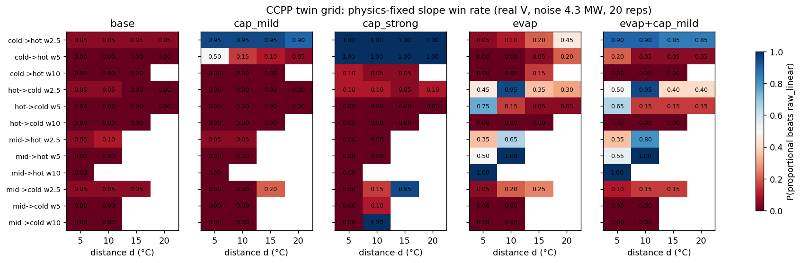

# CCPP 쌍둥이 격자 실험 — 사전 등록

마지막 갱신: 2026-11-04  
상태: **사전 등록. 이 절(§1–§7)은 결과를 보기 전에 썼고 커밋했다.** 결과는 §8에 따로 붙이며, 사전 등록 부분을 고칠 때는 고친 이유와 날짜를 §9에 남긴다.

[CCPP 외삽 설계와 가정](ccpp-extrapolation.md) · [쌍둥이 설계](ccpp-twin-design.md)

## 1. 목적

[설계 기록 §6](ccpp-extrapolation.md#6-사전에-고정할-실험-격자)의 격자를 정답을 아는 쌍둥이 세계에서 돌려 다음을 확인한다.

- **A2:** 비례식(기울기를 물리로 고정)이 어떤 창 위치·폭·거리에서 데이터 적합보다 나은가
- **A1·A3:** 레짐 모듈(저온 상한, 고온 증발냉각)이 있을 때와 없을 때 승패 지도가 어떻게 바뀌는가
- **A4:** V를 고정한 세계와 실제 V를 쓴 세계를 비교해 공변량 범위 이탈의 영향을 분리한다
- **A5:** 잡음이 없는 세계와 있는 세계를 비교해 잡음과 모델 오차를 분리한다
- **A6 (주 기여 가설):** 정답 없이 계산하는 지표가 “물리식이 이기는 조건”을 맞히는가

## 2. 세계 (world) 축

모든 세계는 실제 CCPP 입력 9,568행(AT, V, AP, RH)을 그대로 쓴다. 출력만 쌍둥이로 계산한다. 실제 PE는 이 실험에서 읽지 않는다.

| 축 | 수준 | 이유 |
|---|---|---|
| 레짐 모듈 | `base`, `evap`, `cap_mild`, `cap_strong`, `evap+cap_mild` | S자 양 끝의 원인 가설별 세계 |
| 저온 상한 크기 | mild = 상한 없는 쌍둥이 가스터빈 출력의 97% 분위, strong = 90% 분위 | 실제 PE에 맞추지 않고 쌍둥이 자신의 출력 분포로 정한다(순환 방지). v0 기본값 359 MW는 약 92% 분위였다 |
| V | 실제 V / 전 행 V = 실제 V의 중앙값 | A4. 고정 V 세계에서는 V 범위 이탈이 출력에 영향을 주지 않는다 |
| 잡음 SD | 4.3 MW (주 분석) / 0 (진단) | A5. 4.3은 실데이터 학습 잔차 SD |

세계 수: 5 × 2 × 2 = 20. 잡음 난수는 (세계, 반복) 이름으로 seed를 고정한다.

## 3. 학습 창과 시험 구간

- AT 범위 끝: 0.5%·99.5% 분위(lo = 4.44°C, hi = 33.79°C), 중간 = 중앙값(20.35°C)
- 창 위치와 방향 4가지:
  - `cold→hot`: [lo, lo+w], 시험은 위쪽
  - `hot→cold`: [hi−w, hi], 시험은 아래쪽
  - `mid→hot`, `mid→cold`: [med−w/2, med+w/2], 시험은 각각 위/아래
- 폭 w: 2.5, 5, 10°C. 학습 행 수 n은 폭별로 고정: 146, 300, 1000. 가장 작은 창 후보 행 수(2.5°C: 327행)보다 작아 모든 위치에서 같은 n을 쓸 수 있다
- 반복: 창 후보 행에서 n행을 비복원 추출, 20회
- 외삽 거리 d: 5, 10, 15, 20°C. 시험 구간은 창 끝에서 d만큼 떨어진 2.5°C 폭 구간
- **시험 구간 행이 30행 미만이면 그 칸은 비워 두고 행 수와 함께 “없음”으로 보고한다.** 중간 창의 먼 거리, 넓은 창의 먼 거리는 데이터 범위 밖이라 비게 된다

## 4. 비교군

모두 학습 창 데이터만 쓴다. 시험 정답과 시험 구간 정보로 하이퍼파라미터를 고르지 않는다(D8).

| 이름 | 내용 |
|---|---|
| `raw_linear` | PE ~ AT + V + AP + RH, 최소제곱 |
| `density_linear` | PE ~ r, r = AP/(AT+273.15), 기울기 추정 |
| `proportional` | PE = mean(PE_train)·r / mean(r_train), 기울기를 물리로 고정 |
| `ridge` | 표준화한 4변수, alpha는 창 안 GCV(RidgeCV, 10⁻³–10³) |
| `mlp` | sklearn MLP (32, 32), 표준화, 고정 설정, seed = 반복 번호 |
| `xgboost` | 200 trees, depth 3, learning rate 0.05, 고정 설정 |
| `persistence` | 학습 PE 평균 |

Engression은 설치되어 있지 않아 이번 격자에서 빠진다. 설치 후 같은 격자로 추가한다.

유연한 모형(`ridge`, `mlp`, `xgboost`)은 계산량 때문에 잡음 4.3 세계(주 분석)에서만 돌린다. 닫힌형 모형은 20개 세계 모두에서 돌린다.

## 5. 지표

- 주 지표: 시험 구간 RMSE, **잡음 없는 쌍둥이 출력(pe_clean) 기준**. 잡음 포함 출력 기준 RMSE도 함께 저장한다
- 칸별 시험 행 수, 반복 20회의 평균과 2.5–97.5% 구간
- paired 차이: 같은 반복에서 `proportional` − `raw_linear`
- 승패 라벨: `physics_wins` = RMSE(proportional) < RMSE(raw_linear)

## 6. 정답 없는 판단 지표 (A6)

학습 창 데이터와 시험 입력 X만으로 계산한다.

| 지표 | 정의 | 사전 예상 방향 |
|---|---|---|
| `slope_se` | `raw_linear`의 AT 계수 표준오차 | 클수록 물리식이 이긴다 |
| `slope_gap` | \|AT 계수 − 비례식 기울기\|, 비례식 기울기 = −mean(PE_train)/mean(T_K,train) | 사전 방향 없음 (실데이터에서 두 사례가 반대였다) |
| `gap_z` | slope_gap / slope_se | 클수록 데이터가 이긴다 (데이터가 확신을 갖고 물리와 다르다) |
| `cov_departure` | 시험 행 중 V, AP, RH 하나라도 학습 범위를 벗어나는 비율 | 클수록 물리식이 이긴다 (`raw_linear`의 다른 계수가 외삽된다) |
| `curvature_t` (탐색용) | 창 안 PE ~ AT + AT² 의 이차항 t값 절댓값 | 클수록 물리식이 이긴다 (국소 기울기가 경로를 대표하지 못한다) |
| `distance` (기준선) | d | 지표가 단순히 거리를 대신하는지 확인하는 기준 |

평가:

- 주 분석 세계(잡음 4.3, 10개)에서 각 지표의 AUROC(`physics_wins` 예측). 예상 방향 기준으로 계산한다
- **거리 층화 AUROC**: 같은 d 안에서 계산한 AUROC의 평균. 지표가 거리만 대신하는지 확인한다
- 불확실성: (세계, 창 위치, 폭) 묶음 단위 부트스트랩 1,000회
- **세계 일반화**: 레짐 모듈 하나를 빼고 나머지에서 임계값을 정한 뒤 빠진 세계에서 정확도를 본다 (leave-one-module-out)

`slope_se`가 잡는 것은 분산뿐이고 국소 기울기와 경로 기울기의 차이(곡률에 의한 편향)는 잡지 못한다. 그래서 A6이 성립하지 않을 수 있다는 점을 미리 적는다. `curvature_t`는 이 한계를 보완할 수 있는지 보는 탐색 지표다.

## 7. 사전 예측

결과를 보기 전에 적는다. 틀린 예측도 그대로 §8에 보고한다.

| # | 예측 | 근거 |
|---|---|---|
| P1 | `base` 세계에서는 `proportional`이 `raw_linear`보다 대체로 나쁘다 | 쌍둥이의 중간 구간 기울기(약 −3.4)가 비례식 기울기(약 −1.6)의 두 배 정도다. 실제 CCPP(−2.5 대 −1.6)보다 물리식에 불리한 세계다 |
| P2 | `evap` 세계의 `hot→cold`, w = 2.5에서는 `proportional`이 이긴다 | 고온 끝 국소 기울기가 평평해(약 −0.2) 데이터 기울기가 경로를 대표하지 못한다 |
| P3 | `cap_*` 세계의 `cold→hot`, w = 2.5에서는 `proportional`이 이기고, `cap_strong`에서 더 크게 이긴다 | 저온 끝 데이터 기울기가 0에 가깝다 |
| P4 | 고정 V 세계에서는 `cold→hot` w = 2.5의 `raw_linear` 오차가 실제 V 세계보다 작다 | 실제 V 세계에서는 시험 V의 59%가 학습 범위를 벗어난다 (A4) |
| P5 | `slope_se`와 `curvature_t`는 물리식 승리를 0.5보다 큰 AUROC로 예측하고, `gap_z`는 반대 방향이다. 거리 층화 후에도 유지된다 | A6 |
| P6 | `xgboost`는 d ≥ 10에서 `persistence`와 비슷하다 | 트리는 학습 범위 밖에서 상수로 외삽한다 |

## 8. 결과 (2026-11-04)

실행: `python analysis/ccpp_twin/grid.py <xlsx> --reps 20` (8분, 74,800개 모형×칸 행) → `python analysis/ccpp_twin/summarize_grid.py`. 요약은 `grid_summary.json`, `grid_summary.txt`, 그림은 `grid_winmap.png`에 있다. 칸별 CSV는 크기가 커서 커밋하지 않는다(같은 seed로 재생성된다).

### 8.1 사전 예측 대조

| # | 결과 | 판정 |
|---|---|---|
| P1 | `base` 세계에서 물리식 승률 **2.1%**. 모든 위치·폭에서 진다 | **맞음** |
| P2 | `evap` `hot→cold` w2.5: d = 10에서 승률 95%(차이 −2.8 MW), d = 5에서 45%, d = 15·20에서 35%·30%(진다) | **부분적으로 맞음.** 가까운 거리에서만 이기고 먼 거리에서는 진다 |
| P3 | `cap_mild` `cold→hot` w2.5 승률 90–95%(−7 ~ −17 MW), `cap_strong` 100%(−11 ~ −39 MW). 상한이 강할수록 더 크게 이긴다 | **맞음** |
| P4 | 고정 V 세계에서 `raw_linear` 오차가 줄어든 것은 레짐 모듈이 있는 세계뿐이다(예: `cap_strong` d = 10에서 28.3 → 24.5 MW). `base`에서는 차이가 없거나 반대다(6.3 대 6.6) | **부분적으로 맞음.** 쌍둥이의 V 효과는 약하다(§8.4) |
| P5 | `slope_se` AUROC 0.64 [0.55, 0.72], 거리 층화 0.63. `gap_z`는 예상 방향(클수록 데이터 승) 0.63 [0.55, 0.71]. `curvature_t` 0.46, `cov_departure` 0.49로 **예측력 없음**. 레짐 모듈 하나를 빼고 임계값을 정하면 **어떤 지표도 다수 클래스 기준선을 넘지 못한다** | **대부분 틀림.** A6은 이 형태로는 지지되지 않는다 |
| P6 | d ≥ 10에서 `xgboost` 평균 RMSE 37.3, `persistence` 43.4 MW. `xgboost`가 6 MW 낫다 | **틀림.** 트리가 V·AP·RH의 변화를 쓰기 때문으로 보인다 |

### 8.2 승패 지도가 말하는 것

1. **물리식이 이기는 조건은 “창과 시험 구간 사이에 레짐 경계가 있을 때”다.** 레짐이 없는 `base`에서는 거의 항상 진다. 저온 상한 세계에서는 저온 끝 창, 증발냉각 세계에서는 고온 끝 창과 고온으로 가는 중간 창에서 이긴다.
2. **물리식이 이기는 이유는 맞아서가 아니다.** 비례식 기울기(약 −1.6)는 쌍둥이의 정상 구간 기울기(약 −3.4)와 평평한 구간 기울기(약 0) 사이에 있다. 경계를 넘는 경로의 평균 기울기에 우연히 가까워서 이긴다. 그래서 거리가 멀어져 정상 구간이 길어지면 다시 진다(P2의 d = 15, 20).
3. **창 폭이 넓어지면 승패가 데이터 쪽으로 넘어간다.** w = 10에서는 창이 경계를 포함해 데이터가 경로 기울기를 일부 보게 된다. 실데이터 §3.2의 결과와 같은 방향이다.
4. **잡음은 원인이 아니다.** 잡음 없는 세계의 물리식 승률 23.6%, 잡음 4.3 MW 세계 25.9%로 거의 같다. 승패는 기울기 편향이 정한다.
5. 전체 최저 오차 모형: `raw_linear`·`ridge`가 대부분의 칸에서 최선이고, `proportional`은 레짐 세계에서, `density_linear`는 증발냉각 세계에서 자주 최선이다. `mlp`(고정 설정)는 평균 57 MW로 외삽에서 크게 실패했다.

### 8.3 A6 판단: 창 안 지표로는 레짐 경계를 볼 수 없다

물리식이 이기는 원인은 창 밖의 레짐 경계, 즉 **창 데이터에 없는 정보**다. `slope_se`는 분산만 보고, `curvature_t`는 창 안 곡률만 본다. 둘 다 창 밖의 경계를 볼 수 없다. AUROC 0.63–0.64는 우연보다 낫지만, 세계가 바뀌면 임계값이 옮겨 가 판단 규칙으로 쓸 수 없다.

이 결과는 앞서 논의한 “데이터에 정보가 없으면 데이터만으로는 판단할 수 없다”는 한계를 정량으로 확인한 것이다. 판단에 필요한 정보는 **창 밖에 레짐이 있는가, 창이 레짐 안에 있는가**에 대한 사전 지식(사람이나 LLM의 레짐 진술)에서 와야 한다. 다음 단계의 설계 질문이 여기서 나온다(§8.5).

### 8.4 실데이터와의 대응과 한계

- 실데이터 `hot→cold` w2.5 d10(비례식 5.5 대 데이터 15.5 MW)은 쌍둥이 `evap`·`evap+cap_mild` 세계의 같은 칸(승률 95%)과 일치한다.
- 실데이터 `cold→hot` w2.5 d10(비례식 9.3 대 14.9 MW, 물리식 승)은 `evap` 세계(승률 10%)와 맞지 않고, 저온 상한이 있는 `evap+cap_mild`(90%)와 맞는다. 실제 저온 끝 평탄화에 공변량 효과 외의 레짐이 있을 가능성을 시사한다. **시사일 뿐이며 A7은 아직 확인하지 않았다.**
- 쌍둥이의 정상 구간 기울기가 실제보다 가팔라(−3.4 대 −2.5) `base` 세계는 실제보다 물리식에 불리하다. 쌍둥이의 V 효과(증기터빈 효율 계수 5×10⁻⁴/cmHg)도 실데이터의 V 계수보다 약해 A4 검정력이 낮다. 둘 다 v1 설정 축 후보다.
- Engression은 미실행. MLP는 고정 설정 하나만 썼다.

### 8.5 다음 설계 질문

1. **레짐 진술을 입력으로 받는 판단 규칙:** “창 밖 어디에 평탄 구간이 있다/없다”는 사전 진술(LLM 추천)이 주어지면 승자를 맞히는 정도가 창 안 지표보다 얼마나 오르는가. 진술이 틀린 경우의 손실도 함께 잰다.
2. **고정 기울기 대신 구간별 기울기 prior:** 비례식은 경계를 넘는 경로에서 우연히 맞는다. 레짐별 기울기를 따로 주는 prior가 거리별로 안정적인지 본다.
3. **쌍둥이 v1:** 정상 구간 기울기와 V 효과 크기를 설정 축으로 추가한다.

## 9. 사전 등록 수정 기록

(없음)
