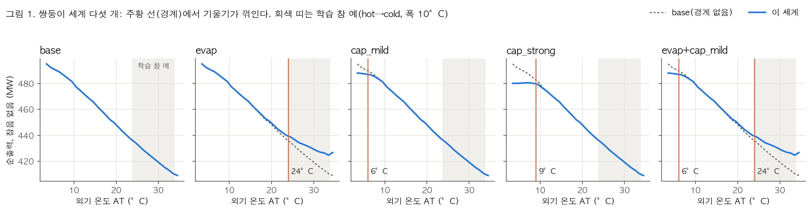
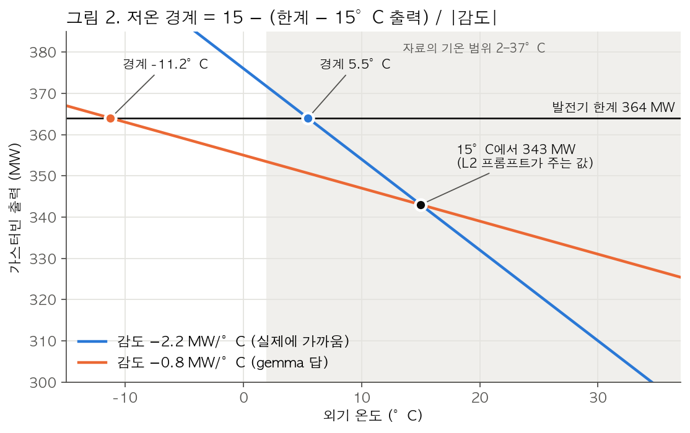
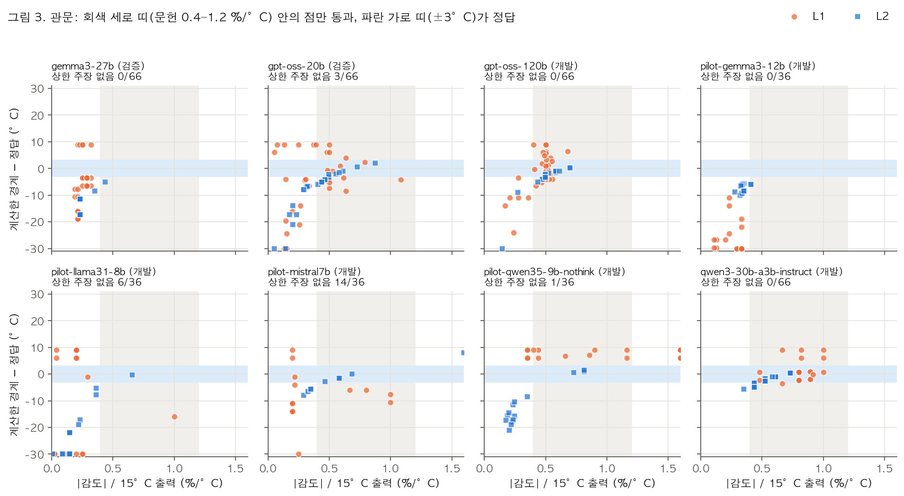
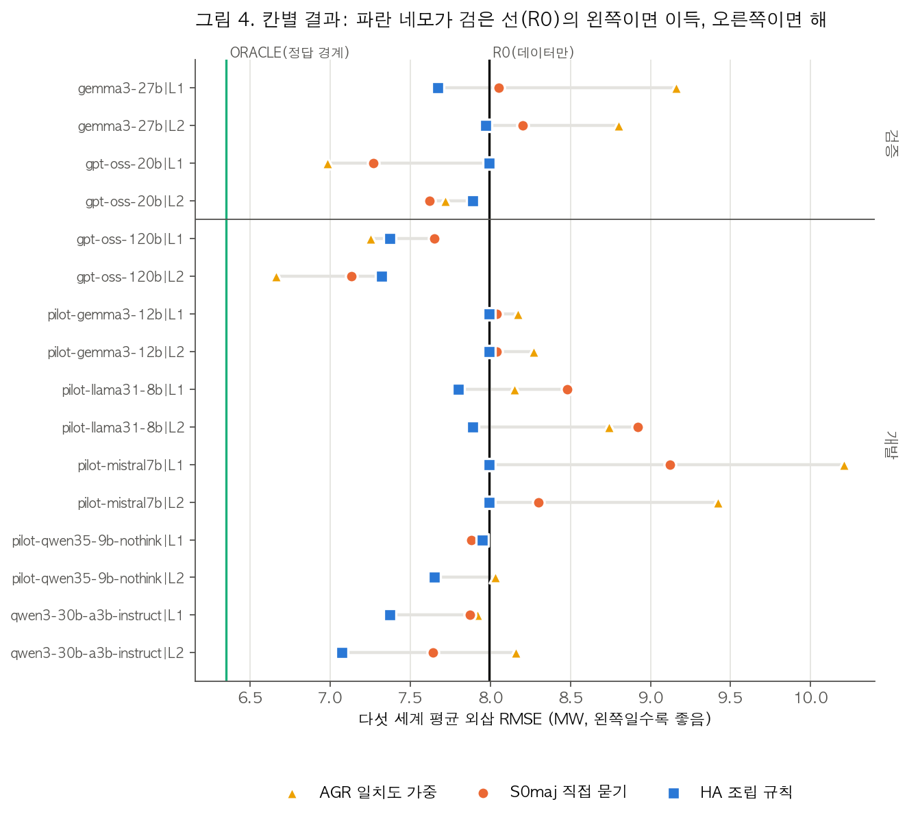

# 힌트 조립 실험 읽는 법

작성: 2026-11-05. 결과를 스스로 해석하고 판단하기 위한 안내서다. 규칙의 정의는 [사전 등록](ccpp-hint-assembly.md)에 있고, 이 문서는 **어떻게 보고 무엇을 의심할지**를 다룬다.

그림은 `python analysis/llm_statements/guide_figures.py <Folds5x2_pp.xlsx>`로 다시 그린다. 새 서버 결과(예: Llama-70B)를 받으면 먼저 `assemble.py`를 돌리고, 이어서 이 스크립트를 돌리면 그림 3·4가 갱신된다.

## 0. 한 문단 요약

학습 데이터가 없는 기온 구간을 예측(외삽)하면, 데이터만 쓴 모델은 추세를 그대로 연장한다. 실제 설비에는 기울기가 꺾이는 경계가 있어서 외삽이 틀린다. LLM에게 경계에 대한 힌트를 받는다. 힌트는 **부품으로 쪼개 묻고 → 검사하고 → 다수결로 골라 → 데이터 모델과 반반 섞는다**. 이 조립 규칙(`HA`)이 ① 나쁜 힌트에도 해가 없고(H1) ② 직접 묻는 것보다 나은지(H2)를 정답을 아는 쌍둥이 세계에서 잰다.

## 1. 데이터: 무엇이 어디에 있나

| 파일 | 내용 | 한 줄 = |
|---|---|---|
| `analysis/llm_statements/runs/<tag>.jsonl` | 본 수집. 경계를 직접 묻는 S0 | LLM 호출 1번 |
| `runs/pilot/*.jsonl` | 소형 모델의 본 수집 | 〃 |
| `runs/strategy/<tag>.jsonl` | 묻는 방식 실험. S1(먼저 추론), S2(부품 질문) | 〃 |
| `runs/env/<tag>.txt` | 서버 실행 환경 (GPU, vLLM 인자) | — |
| `runs/assembly/assembly.{txt,json}` | 조립 규칙 결과와 H1–H5 판정 | — |
| `runs/strategy/compare-<tag>.txt` | 전략별 구조 정답률 | — |

jsonl 한 줄의 주요 필드:

| 필드 | 뜻 | 값 예 |
|---|---|---|
| `tag` | 모델 | `gemma3-27b` |
| `world` | 쌍둥이 세계 (§2) | `cap_mild` |
| `level` | 프롬프트 정보 수준 (Level) | `L0`, `L1`, `L2` |
| `strategy` | 묻는 방식 (Strategy) | `S0`, `S1`, `S2` |
| `data` | 창 요약을 같이 주는지 | `D0`, `D1` |
| `sample`, `temperature` | 같은 질문을 몇 번째로 물었는지, 샘플링 온도 | `0`–`9`, `0.7` |
| `messages` | 실제로 보낸 프롬프트 | — |
| `response` | 모델 답 (JSON 문자열) | — |
| `error` | 호출 오류 (정상이면 `null`) | — |

**직접 열어보기** (저장소 최상위에서):

```python
import json, pandas as pd
rows = [json.loads(l) for l in open("analysis/llm_statements/runs/strategy/gemma3-27b.jsonl")]
df = pd.DataFrame(rows)
print(df.groupby(["strategy", "level", "world"]).size())
r = df[(df.strategy == "S2") & (df.world == "cap_mild") & (df.level == "L2")].iloc[0]
print(r.messages[-1]["content"])   # 보낸 질문
print(r.response)                  # 모델 답
```

## 2. 원리 ①: 쌍둥이 세계



- 실제 CCPP 데이터의 기온·기압·습도·진공도를 그대로 넣고, 출력은 **물리 모델(`ccpp_twin.py`)이 계산**한다. 그래서 정답 경계를 우리가 안다.
- 세계 다섯 개:

  | 세계 | 정답 경계 |
  |---|---|
  | `base` | 없음 |
  | `evap` | 24°C 위 (증발 냉각) |
  | `cap_mild` | 6°C 아래 (발전기 한계) |
  | `cap_strong` | 9°C 아래 |
  | `evap+cap_mild` | 둘 다 |

- **읽는 법:** 주황 선에서 파란 선이 점선(base)과 갈라진다. 학습 창(회색 띠)이 23–34°C처럼 따뜻한 쪽에만 있으면, 데이터만으로는 6°C 아래의 평평함을 알 수 없다. 그 정보를 LLM 힌트로 채우려는 것이다.
- 잡음 4.3 MW(실제 CCPP 잔차 수준)를 더해 학습한다. 채점은 잡음 없는 출력으로 한다.

## 3. 원리 ②: 부품 질문(S2)을 경계로 바꾸는 계산



S2에서는 경계를 묻지 않고 부품을 묻는다.
- 가스터빈 감도 (MW/°C)
- 15°C 출력
- 발전기 한계
- 메커니즘이 켜지는지 (anti-icing, 증발 냉각, 배기 한계)

기온이 내려가면 출력이 오르다가 한계에 닿는다. 닿는 온도가 저온 경계다.

> 경계 = 15 − (한계 − 15°C 출력) / |감도|

- **읽는 법:** 감도가 맞으면(파란 선) 경계는 5.5°C로 정답(6°C)에 가깝다. gemma처럼 감도를 1/3로 답하면(주황 선) 기울기가 완만해져 −11°C에 닿는다. 자료 범위 밖이니 "경계 없음"과 같다.
- **핵심:** 경계는 검사할 수 없지만 **감도는 검사할 수 있다**. 가스터빈 감도는 문헌상 출력의 0.4–1.2 %/°C다([도메인 점검](ccpp-domain-check.md) §2). 이것이 관문이다.
- L2에서는 15°C 출력(343 MW)을 프롬프트가 주므로 모델 답 대신 343을 쓴다. 감도는 프롬프트에 없다.

## 4. 원리 ③: 관문이 하는 일



- 점 하나 = S2 답 하나다. 상한이 있는 세 세계에서 "상한에 닿는다"고 답한 경우만 찍었다.
- **x축:** 모델이 답한 감도를 15°C 출력에 대한 %로 바꾼 값이다. 회색 세로 띠(0.4–1.2) 안에 있으면 관문을 통과한다.
- **y축:** 계산한 경계 − 정답 경계다. 파란 가로 띠(±3°C) 안이면 정답이다. ±30을 넘는 값은 가장자리에 붙여 그렸다.
- **좋은 관문의 모습:** 회색 띠 안의 점이 파란 띠에 모이고, 띠 밖의 점은 파란 띠 밖에 흩어진다.
  - `qwen3-30b`, `gpt-oss-120b`: 띠 안 점이 대부분 정답 근처에 있다.
  - `gemma3-27b`: 모든 점이 띠 왼쪽(0.2–0.3%)에 있고 모두 틀렸다. 관문이 전부 버렸다.
  - `gpt-oss-20b`: 띠 안에 맞는 점이 있지만 소수다. 그래서 다수결에서 사라졌다(§5).
- **관문이 못 거르는 경우:** `pilot-qwen35-9b` L1은 띠 안에 있지만 +6~+9°C로 틀렸다. 감도는 그럴듯한데 한계나 15°C 출력을 틀린 경우다. 관문은 감도만 검사한다.

## 5. 결과 읽기: 칸별 RMSE



- **칸 = 모델 × 정보 수준**이다(예: `gemma3-27b|L1`). 값은 다섯 세계와 여러 학습 창·시험 거리를 평균한 외삽 RMSE(MW)다.
- **기준선 두 개:**
  - 검은 선 `R0`(7.99): LLM 없이 데이터만 쓴 경우다. **이 선의 오른쪽은 LLM이 해를 끼친 것이다.**
  - 초록 선 `ORACLE`(6.35): 정답 경계를 알려준 경우다. 도달 가능한 최선이다.
- **비교 대상:**

  | 표시 | 이름 | 뜻 |
  |---|---|---|
  | 파란 네모 | `HA` | 우리 조립 규칙 |
  | 주황 원 | `S0maj` | 경계를 직접 물어 다수결 |
  | 노란 삼각형 | `AGR` | 직접 물은 답을 자기 일치도만큼 믿기 |

- **이 그림에서 보이는 패턴:**
  1. 파란 네모는 모든 칸에서 검은 선 위나 왼쪽에 있다. → H1(해 없음)
  2. 주황·노랑은 소형 모델(mistral, llama 8B)과 gemma-27b에서 크게 오른쪽으로 나간다. 직접 물으면 해가 크다.
  3. 대신 힌트가 좋은 칸(`gpt-oss-120b`, `gpt-oss-20b`)에서는 파란 네모가 주황·노랑보다 오른쪽이다. **안전한 대신 보수적이라 이득을 덜 챙긴다.**
- **개발/검증 구분이 중요하다.** 개발 칸(아래)은 규칙을 만들 때 본 자료라 낙관적이다. 판정은 검증 칸(위, 처음 보는 모델)으로만 한다.

## 6. 판정 기준 (검증 6칸)

| 예측 | 무엇을 보나 | 통과 기준 | 그림에서 보는 곳 |
|---|---|---|---|
| H1 해 없음 | `HA` ≤ `R0` + 0.10 | 6칸 모두 | 그림 4: 파란 네모가 검은 선 오른쪽으로 0.1 넘게 안 나감 |
| H2 직접 묻기보다 나음 | `HA` < `S0maj` | 4칸 이상 | 그림 4: 파란 네모가 주황 원보다 왼쪽 |
| H3 관문이 일함 | 통과 부품 정답률 − 탈락 부품 정답률 | ≥ 0.15 | 그림 3: 검증 모델 패널 |
| H4 관문이 조립을 도움 | `HA` ≤ `HA−gate` | 4칸 이상 | `assembly.txt` 표 |
| H5 일치도로는 안 됨 | `AGR` < `S0maj`인 칸 | 3칸 이하 | 그림 4: 노란 삼각형이 주황 원보다 왼쪽인 칸 수 |

현재(2026-11-05) 4칸 기준 결과다.
- H1·H3 충족, H5 확정 충족.
- H2는 2/4라 Llama-70B 2칸이 모두 이겨야 한다.
- H4는 3/4라 1칸이 더 필요하다.

## 7. 판단할 때 스스로 물어볼 것

결과가 좋아 보여도 다음을 의심해야 한다. 심사자도 같은 질문을 할 것이다.

1. **관문은 우리가 넣은 지식이 아닌가?** 감도 범위 0.4–1.2%는 우리가 문헌에서 가져왔고, 실제 값(약 0.64%)이 그 안에 있다.
   - 방어 논리: 범위는 넓고, 경계 자체는 주지 않는다. 관문은 일반 문헌 지식으로 "검사 가능한 부품"만 확인한다.
   - 약점: 범위를 좁게 잡을수록 정답을 흘리는 셈이 된다. 범위 민감도 분석이 필요할 수 있다.
2. **이득은 어디서 오나?** `HA`가 `R0`보다 나은 칸이 상한 부품 때문인지, 증발 냉각 부품 때문인지 나눠 본다. gemma L1의 이득은 증발 냉각에서 왔다.
3. **개발 자료로 규칙을 고친 효과는 아닌가?** 규칙 v2는 개발 자료를 보고 골랐다. 그래서 검증 칸만 증거로 친다.
4. **세계가 다섯 개뿐이다.** 메커니즘은 상한과 증발 냉각 두 종류다. 결빙 방지 세계([설계](ccpp-anti-icing-world.md))는 "모델이 모르는 메커니즘"을 시험하려고 준비해 두었다.
5. **시뮬레이션이다.** 쌍둥이는 실제 CCPP 입력을 쓰지만 출력은 우리 물리 모델이다. 실제 데이터 검증은 마지막 단계다.
6. **"안전하지만 이득이 작다"가 기여로 충분한가?** H2가 실패하면 주장은 "나쁜 힌트원에서도 해가 없는 조립"으로 좁아진다. 이것만으로 논문이 되는지는 [리뷰](reviews/2026-11-04-hint-assembly.md)의 선행연구 비교를 다시 봐야 한다.

## 8. 직접 분석해 보기

```bash
cd analysis/llm_statements
python assemble.py <Folds5x2_pp.xlsx> --out runs/assembly/assembly     # 조립 규칙 결과·판정
python guide_figures.py <Folds5x2_pp.xlsx>                            # 이 문서의 그림
python compare_strategies.py <xlsx> --s0 runs/<tag>.jsonl --s12 runs/strategy/<tag>.jsonl --out runs/strategy/compare-<tag>
```

해볼 만한 질문:
- 모델별로 S2 답에서 "anti-icing이 켜진다"고 답한 비율은 얼마인가? 이 세계에는 anti-icing이 없으니 거짓 주장이다.
- `SENS_GATE_PCT`(`assemble.py` 26행)를 0.3–1.5로 넓히면 결과가 얼마나 바뀌나? 이것은 탐색 분석이다. 사전 등록 판정에는 쓰지 않는다.
- 그림 3에서 띠 안인데 틀린 점은 한계값과 15°C 출력 중 무엇을 틀렸나?
